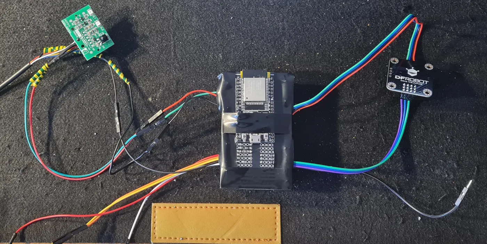
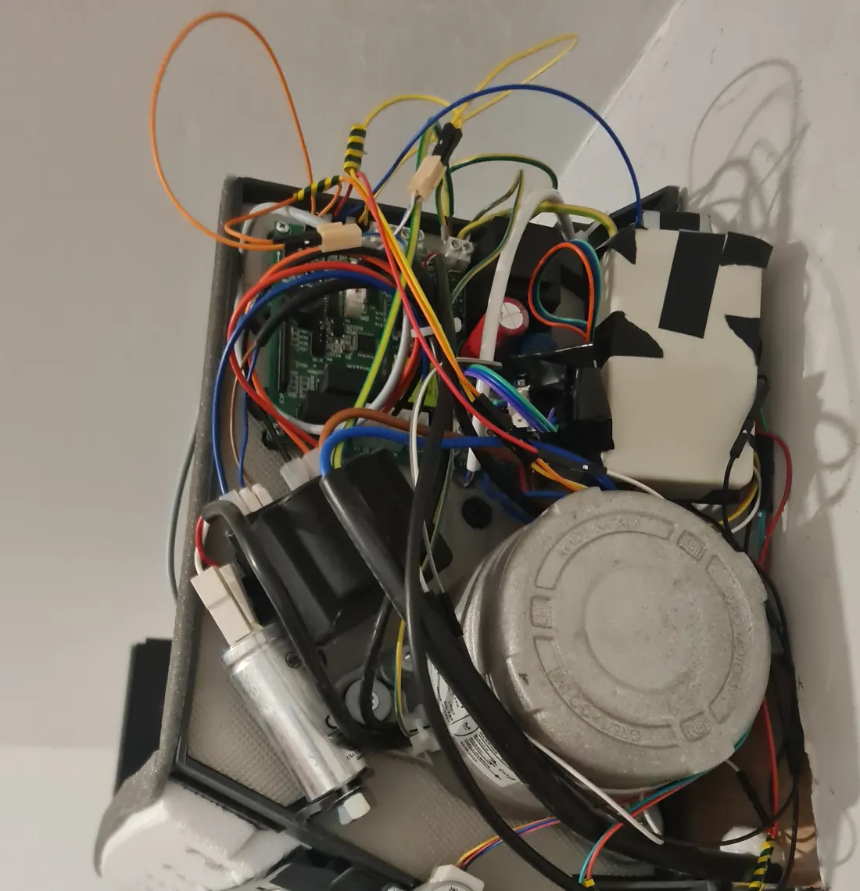
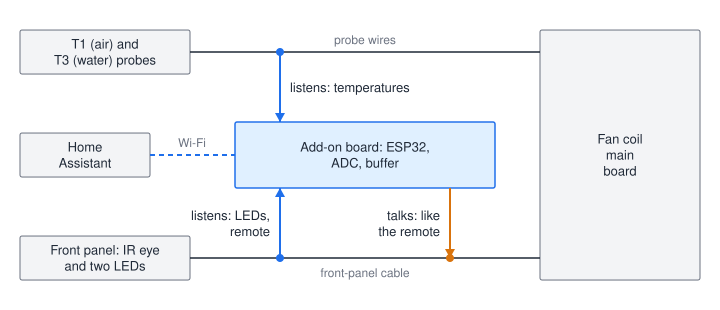

# esphome-carrier-42wm

Local Home Assistant control of a **Carrier 42WM** hydronic fan coil (Idrofan
wall unit, infrared-remote version) with an ESP32 and [ESPHome](https://esphome.io).

The ESP32 sits inside the appliance, on the cable between the front panel and
the main board. It talks to the main board exactly like the remote does, hears
what the real remote sends, and reads the appliance's own two temperature
probes. No cloud, no IR blaster on the opposite wall, and nothing soldered on
the appliance boards.

> [!NOTE]
> **Built with AI assistance.** This project was made together with
> [Claude](https://claude.com/claude-code), Anthropic's AI model: protocol
> analysis, ESPHome component, configuration and this documentation were
> largely written by Claude, under my direction. All measurements, wiring and
> tests were done by hand on my own appliance. See [AI disclosure](#ai-disclosure).

<p>
  
  
</p>

## What you get

| Entity | Type | Notes |
|---|---|---|
| Fan coil | `climate` | Off / auto / fan only / heat / cool, 10–30 °C in 1 °C steps, fan auto / low / medium / high, swing |
| T1 return air | `sensor` | The appliance's own air probe; also the climate entity's current temperature |
| T3 water | `sensor` | Probe on the water pipe: tells whether hot or cold water is actually flowing |
| Red LED, Green LED | `binary_sensor` | State of the two front-panel LEDs |

The original remote keeps working. Every frame it sends is decoded and updates
the entity in Home Assistant.

## How it works



- **Talking.** The front panel's IR receiver output reaches the main board on
  one wire. That wire is cut and a 2 kΩ resistor inserted; a transistor on the
  main-board side lets the ESP32 pull the line low and replay remote frames,
  already demodulated.
- **Listening.** On the panel side of the same wire, a 10 kΩ tap feeds the
  ESP32 with whatever the real remote sends.
- **Measuring.** An ADS1115 reads the voltage of the two NTC probes in
  parallel with the main board, plus the board's 5 V as a reference.

The ESP32 can do nothing the remote cannot: the original board keeps driving
the fan and the valve with all its safeties. If the ESP32 is off or crashed,
the remote signal simply goes through the 2 kΩ resistor and the appliance
behaves as it did from the factory. Removing the add-on means joining one wire
back together.

## Compatibility

Tested on **one** appliance only.

| Appliance | Status |
|---|---|
| Carrier 42WM100CTG-A, remote RR03-S | Confirmed: the unit this was built on |
| 42WM200 / 300 / 400, IR-remote ("T") version | Probable: same range, same remote; not tested |
| 42WM109–409 | Possible; not tested |
| Other fan coils with a separate IR front panel | The principle carries over; the protocol and wiring will differ |

Three quick checks before buying anything:

1. The remote is an RR03-S (or the unit is listed for it).
2. The front panel is a separate board, linked to the main board by a cable.
3. The temperature probes plug into the main board with 2-pin connectors.

## Hardware

A few tens of euros of common parts and about two days of work, mostly
careful measuring and re-checking. You need a
multimeter, a soldering iron and some patience.

- ESP32 dev board (AZDelivery DevKitC V4)
- DFRobot DFR0553 ADS1115 module
- 4050 hex buffer, 2N2222A transistor, a handful of resistors and 100 nF capacitors
- Solderable half-breadboard
- MEAN WELL RS-15-5 isolated 5 V supply

| ESP32 pin | Function |
|---|---|
| GPIO26 | IR out (to the transistor) |
| GPIO33 | IR in (from the front panel, through the 4050) |
| GPIO35 | Red LED (through the 4050) |
| GPIO39 | Green LED (through the 4050) |
| GPIO27 / GPIO22 | I²C SDA / SCL to the ADS1115 |

Full parts list, circuit, wire colours and the checks to run before closing
the cover: **[docs/hardware.md](docs/hardware.md)**.

> [!CAUTION]
> The appliance and the add-on power supply run on mains voltage: switch off
> the breaker before opening the cover. One wire of the front-panel cable
> carries about 20 V and must never reach the ESP32. Once the ESP32 is wired
> to the appliance, never plug in its USB port; update it over Wi-Fi.
> You do this at your own risk.

## Firmware

Developed with ESPHome 2026.8.1.

```sh
git clone https://github.com/Petititi/esphome-carrier-42wm.git
cd esphome-carrier-42wm
cp secrets.example.yaml secrets.yaml    # then fill it in
esphome run carrier-42wm.yaml
```

Do the first flash over USB **before** the ESP32 goes on its board; later
updates go over the air. Home Assistant then discovers the device; enter the
API encryption key from `secrets.yaml` to adopt it.

If your probes or your board differ, the divider resistors and NTC parameters
are substitutions at the top of [`common.yaml`](common.yaml).

| File | Purpose |
|---|---|
| `carrier-42wm.yaml` | Production firmware: the climate entity |
| `carrier-42wm-learning.yaml` | Exploration firmware: web page on port 80, raw frame log, test transmissions, bit-flip tests |
| `common.yaml` | Shared part: Wi-Fi, probes, LEDs, IR output |
| `components/carrier_ac84/` | ESPHome climate component for the protocol |
| `tools/test_ac84.py` | Checks the codec against real captures (`python3 tools/test_ac84.py`) |

Both firmwares share the same device name and OTA password, so you can switch
between them with a plain OTA flash.

### Using the component alone

`carrier_ac84` is a `climate_ir` platform written for this wired setup: it
sends frames without the 38 kHz carrier. Driving an IR LED in front of the
appliance would need the carrier restored in `transmit_state()`; that has not
been tried.

```yaml
external_components:
  - source: github://Petititi/esphome-carrier-42wm
    components: [carrier_ac84]

climate:
  - platform: carrier_ac84
    name: "Fan coil"
    transmitter_id: ir_tx
    receiver_id: ir_rx      # optional
    sensor: room_temp       # optional
    time_id: sntp_time      # optional: clock sent in each frame
```

## IR protocol

84 bits, LSB first, 5850/1175 µs header, known as `CARRIER_AC84` in
[IRremoteESP8266](https://github.com/crankyoldgit/IRremoteESP8266), which
encodes and decodes the bits but does not interpret them. Every frame carries
the full state: power, mode, fan speed, setpoint, swing, timer, clock and a
checksum.

```
0C 13 03 33 00 12 00 12 13 14 54    on, heat, low speed, 30 °C, sent at 14:13
```

Field layout, checksum, captures and what has and has not been verified:
**[docs/ir-protocol.md](docs/ir-protocol.md)**.

## Limitations

- **The appliance beeps on every command**, as it does with the remote. No bit
  in the frame turns this off; the candidates were tested one by one.
- **The entity shows the requested state, not the actual one.** The appliance
  gives no feedback. If it has no hot water, it will not heat; watch T3 to
  know what is really happening.
- **Fan speed "auto" and the timer were never captured from the remote.** Auto
  is sent as value 0, by analogy with the mode field, and is unverified; the
  timer is not used.
- **The NTC curve is assumed** (10 kΩ, β 3950) from a single measurement point,
  about 12 kΩ at 21 °C. Readings are consistent at room temperature; the error
  with hot or chilled water is unknown.
- Tested on a single appliance.

## AI disclosure

This project was developed with [Claude Code](https://claude.com/claude-code)
(Anthropic's Claude) as a working partner.

- **Written mostly by Claude**: the `carrier_ac84` component, the ESPHome
  configurations, the test tool, the diagrams and this documentation,
  including its translation from my French notes.
- **Done by me**: the idea, every measurement on the appliance, the board
  design choices, all soldering and wiring, and every test on the real unit.
  Each step was checked on the hardware before moving to the next one.

The firmware in this repository is an English translation of the one running
in my appliance: entity names, comments and log messages changed, the logic
did not. This translated version passes `esphome config` and the codec tests, but
has not itself been flashed to the appliance yet. Treat it like any hobby project: read it before trusting it with your
own appliance.

## Credits

- [IRremoteESP8266](https://github.com/crankyoldgit/IRremoteESP8266): the
  `CARRIER_AC84` timings come from
  [issue #1943](https://github.com/crankyoldgit/IRremoteESP8266/issues/1943)
  and [PR #1945](https://github.com/crankyoldgit/IRremoteESP8266/pull/1945)
  by David Conran.
- [ESPHome](https://esphome.io) and [Home Assistant](https://www.home-assistant.io).

Not affiliated with Carrier.
