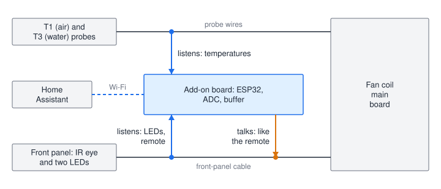
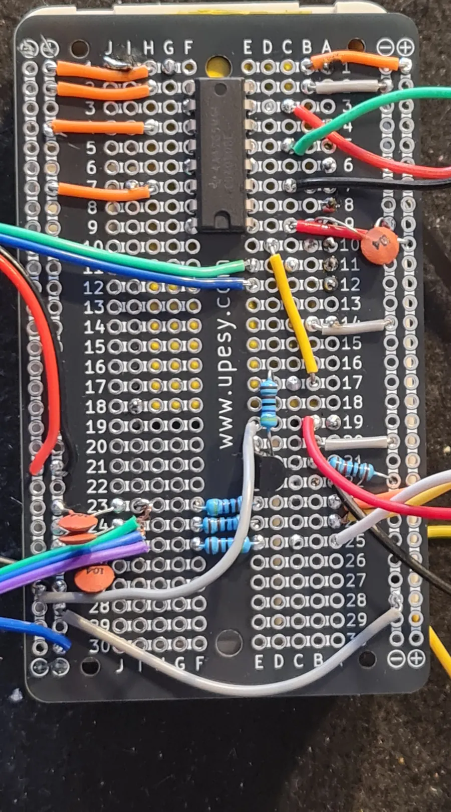
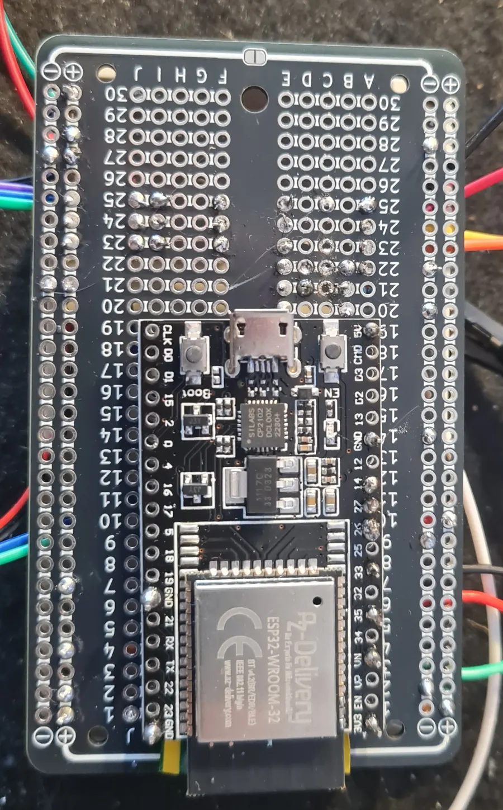
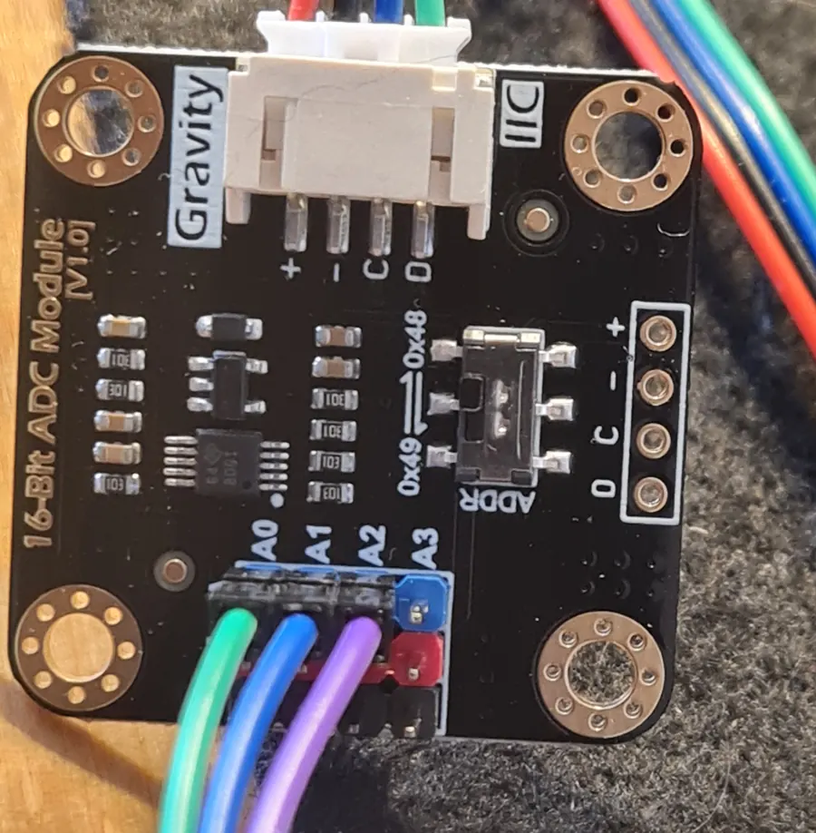
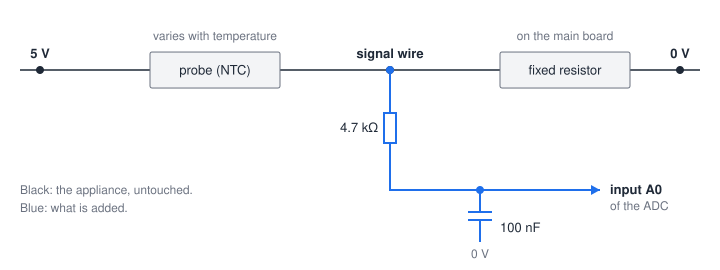
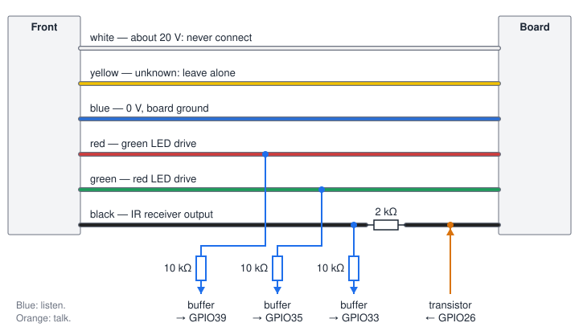
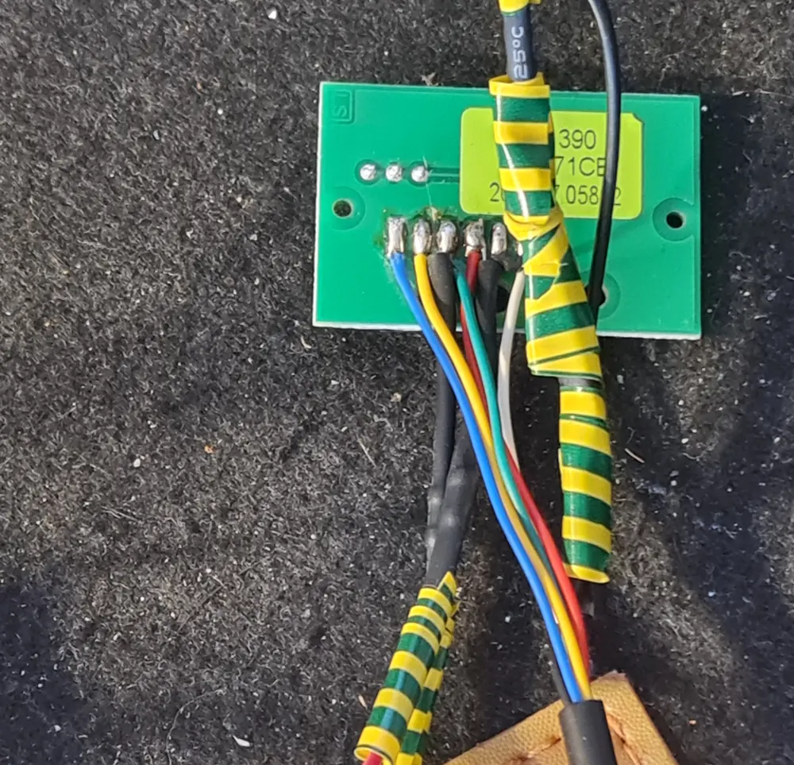
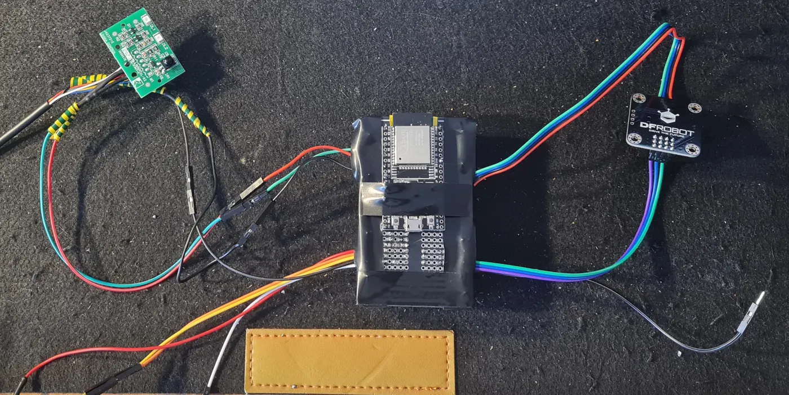
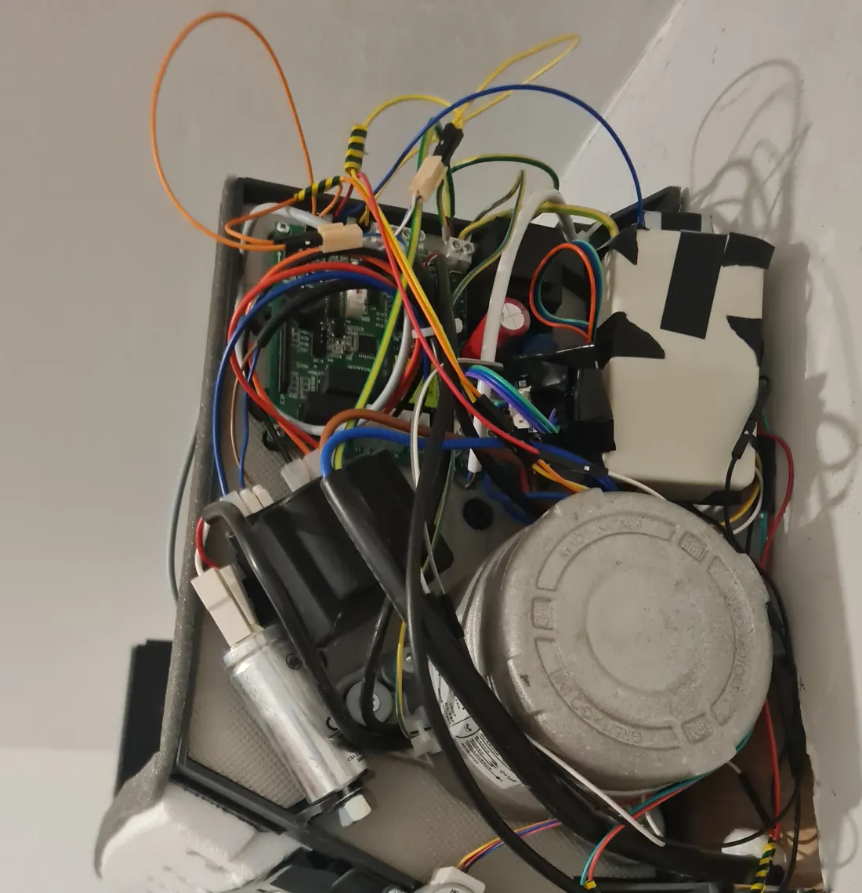

# Hardware

Built and tested on a single appliance: a **Carrier 42WM100CTG-A** (Idrofan
wall-mounted fan coil, infrared-remote "T" version) with the RR03-S remote.
Wire colours, voltages and probe values below are the ones measured on that
unit. **Check yours with a multimeter before connecting anything.**

> [!CAUTION]
> The appliance runs on mains voltage, and so does the add-on power supply.
> Switch off the breaker before opening the cover and check that no voltage is
> present before touching the terminal block. If you are not used to mains
> wiring, get help for that step.

## Principle

The appliance has two boards. The front panel carries the IR receiver and two
LEDs; a six-wire cable links it to the main board, which makes every decision.
Two temperature probes plug into the main board: T1 in the return air, T3 on
the water pipe.

The add-on connects to those **wires**, never to the boards.

- **Nothing is soldered on the appliance boards.** One wire is cut, the others
  are tapped. Removing the add-on means joining one wire back together.
- **The ESP32 can do nothing the remote cannot.** It does not touch the fan,
  the valve or the mains: it sends a frame, and the original board does the
  rest with all its safeties.
- **Powered off or crashed, it gets out of the way.** The remote signal then
  goes through a plain resistor and the appliance behaves as it did from the
  factory.

## Parts

| Part | Role |
|---|---|
| ESP32 dev board, 38 pins (AZDelivery DevKitC V4) | MCU and Wi-Fi |
| Solderable half-breadboard, 30 columns (uPesy, 87 × 53 mm) | Carries everything |
| DFRobot DFR0553 ADS1115 module | 16-bit ADC for the probe voltages |
| 4050 hex buffer (HEF4050BP, CD4050BE or 74HC4050) + DIP-16 socket | Brings the appliance's 5 V signals down to 3.3 V |
| 2N2222A transistor | Lets the ESP32 talk on the IR wire |
| Resistors: 4 × 4.7 kΩ, 4 × 10 kΩ, 1 × 2 kΩ | Protection and filters |
| 4 × 100 nF ceramic capacitors | Filters, decoupling |
| MEAN WELL RS-15-5 (mains → 5 V) | Isolated supply for the add-on |
| Tall female headers, one 2-pin plug matching the probe connectors, wire, heat-shrink, Kapton tape | Connections |

The DFR0553 pulls its I²C bus up to its own 3.3 V, so it connects straight to
the ESP32 without a level shifter. The separate power supply avoids drawing
current from the appliance board, which is not designed for it.

## Circuit

| Signal | From | Through | To |
|---|---|---|---|
| T1 (return air) | Signal wire of the T1 probe | 4.7 kΩ series, 100 nF to GND | ADS1115 A0 |
| T3 (water) | Signal wire of the T3 probe | 4.7 kΩ series, 100 nF to GND | ADS1115 A1 |
| 5 V reference | 5 V pin of the unused T2 probe input | 4.7 kΩ series, 100 nF to GND | ADS1115 A2 |
| Green LED | Red wire of the panel cable | 10 kΩ at the tap, 4050 (pin 7 → 6) | GPIO39 |
| Red LED | Green wire of the panel cable | 10 kΩ at the tap, 4050 (pin 5 → 4) | GPIO35 |
| IR in | Black wire, panel side | 10 kΩ at the tap, 4050 (pin 3 → 2) | GPIO33 |
| IR out | GPIO26 | 4.7 kΩ to the base of the 2N2222A (10 kΩ base to GND), emitter to GND | Collector on the black wire, main-board side |
| I²C | GPIO27 (SDA), GPIO22 (SCL) | direct | ADS1115 module D, C |

- The 4050 is powered from the ESP32 **3.3 V** pin (pin 1), not 5 V: that is
  what makes it a level translator. Pin 8 to GND, 100 nF across the supply,
  unused inputs (9, 11, 14) to GND.
- The RS-15-5 output (trimmed to 5.0–5.1 V, no load) feeds the ESP32 `5V` pin
  and the ADS1115 module.
- **One single ground wire** joins the add-on to the appliance: the 0 V pin of
  the unused T2 probe input. Without it every measurement is wrong.

### The board

The ESP32 sits **under** the board on female headers, everything else on top,
so the assembly stays flat and slides into the appliance. Headers are fitted
only under the pins actually used: a full-length header would connect unused
ESP32 pins to strips that carry 5 V signals.

| Top | Bottom |
|---|---|
|  |  |

The ADC module stays next to the board:

**Before connecting anything**: no continuity between the 3.3 V rail, the 5 V
rail and ground. Flash the ESP32 over USB while it is out of the board; once
installed, it is updated over Wi-Fi only.

## The two probes

A probe is an NTC in series with a fixed resistor on the main board, between
5 V and 0 V. The board reads the voltage in the middle; the add-on reads the
same voltage.

Each probe reaches the board through a 2-pin plug. A Y-lead between the probe
and its socket avoids cutting anything. To find which of the two wires to tap,
power the appliance, measure each wire against ground and warm the probe with
your fingers:

| Reading | Meaning |
|---|---|
| Between 1 and 4 V, moves when the probe warms up | Signal wire: tap this one |
| About 5 V, steady | The other wire |
| About 0 V | Probe unplugged |

On this unit at 21 °C: 2.3 V on T1 and 1.65 V on T3. They differ because the
fixed resistor is not the same on both inputs: about 10 kΩ for T1 and 5.6 kΩ
for T3 (`r_pd_t1` / `r_pd_t3` in `common.yaml`). Both probes measure about
12 kΩ at 21 °C, most likely NTC 10 kΩ β3950; this comes from a single
measurement point.

The third ADC input reads the board's 5 V so the computation does not depend
on its exact value. It is taken on the unused T2 probe input. This is a
reference, not a supply: nothing else may be connected to it.

## The front-panel cable

| Wire | Role | Use |
|---|---|---|
| White | Unregulated supply, about 20 V | **Never connect** |
| Yellow | Unknown | Leave alone |
| Blue | 0 V | Reference for measurements |
| Red | Drives the green LED | Tapped through 10 kΩ |
| Green | Drives the red LED | Tapped through 10 kΩ |
| Black | IR receiver output | Cut, 2 kΩ in series |

- **LED wires** are tapped without cutting them: a small window in the
  insulation, the lead of a 10 kΩ resistor wrapped and soldered, tape on top.
  The resistor sits right at the wire, so a fault further away cannot disturb
  the appliance.
- **The black wire** is the only one cut. A 2 kΩ resistor is soldered between
  the two ends. On the panel side a 10 kΩ tap listens to the real remote. On
  the board side the transistor pulls the line low to talk. When the ESP32 is
  silent, the remote signal simply goes through the resistor.

> [!WARNING]
> Before tapping, measure every wire against the blue one with the appliance
> powered. You must find about 20 V on one wire only, and nothing above 5 V on
> the wires you are going to use.

## Checks before closing the cover

| Check | Expected |
|---|---|
| The appliance, with its remote | Works exactly as before |
| ESP32 boot log | ADC found at address `0x48` |
| T1 and T3, appliance idle for a while | Close to room temperature, within 1 °C of each other |
| 5 V reference | 4.9 to 5.2 V |
| Green LED lit on the panel | The matching entity turns on |
| A key press on the remote | The ESP32 logs a received frame |
| A command from Home Assistant | The appliance beeps and obeys |

> [!IMPORTANT]
> If the appliance misbehaves, unplug the ESP32 and the ADC module first. If
> the ADC loses its supply while the appliance is powered, its inputs pull the
> probe lines down and the main board reads wrong temperatures.

Once the ESP32 is wired to the appliance, do not plug its USB port into a
computer: it would be powered from both sides. Pull it off its headers if USB
is ever needed.

Wrap the board in insulation and place it in a dry corner, away from the
condensate tray and the coil.

